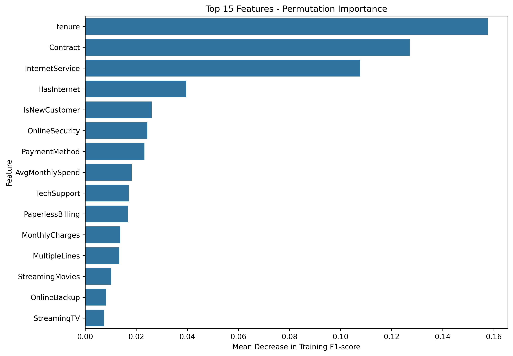

# Customer Churn Prediction Using Machine Learning

## Project Overview

This project develops a machine learning classification model to predict customer churn using the IBM Telco Customer Churn dataset.

The objective is to identify customers who may leave a telecommunications company and examine the factors associated with customer retention.

## Dataset

- Source: IBM Telco Customer Churn
- Customer records: 7,043
- Original columns: 21
- Target variable: Churn (Yes/No)

## Tools and Technologies

Python, pandas, NumPy, Matplotlib, Seaborn, scikit-learn, Google Colab and joblib.

## Project Workflow

1. Data loading and data quality assessment
2. Missing-value treatment and data cleaning
3. Exploratory Data Analysis (EDA)
4. Correlation analysis
5. Feature engineering
6. Categorical encoding and numerical scaling
7. Stratified train/test splitting
8. Machine learning model training
9. Five-fold cross-validation
10. Hyperparameter tuning
11. Classification threshold optimisation
12. Final test-set evaluation
13. Feature importance and interpretation
14. Model saving and reuse

## Machine Learning Models

Three classification algorithms were compared:

- Logistic Regression
- Decision Tree
- Random Forest

Logistic Regression achieved the highest cross-validation F1-score among the initial models.

## Final Model Performance

The selected model was Logistic Regression with a classification threshold of 0.30.

| Metric | Final Test Result |
|---|---:|
| Accuracy | 75.59% |
| Precision | 52.81% |
| Recall | 75.40% |
| F1-score | 62.11% |
| ROC-AUC | 84.16% |

Threshold optimisation improved recall from 52.94% to 75.40%, allowing the model to identify 84 additional churned customers in the held-out test dataset, at the cost of more false-positive predictions.

## Key Findings

Permutation importance identified tenure, contract type and internet service as the features the model relied on most.

Exploratory analysis also revealed that month-to-month contracts and shorter customer tenure were associated with higher churn.

These findings are observational associations and do not establish causation.

## Conclusion

This project demonstrates an end-to-end supervised machine learning workflow, including data preprocessing, feature engineering, classification, cross-validation, model comparison, threshold optimisation, evaluation and model interpretation.

The final Logistic Regression pipeline was saved for reuse, along with its selected classification threshold.

## Model Comparison

The following chart compares Logistic Regression,
Decision Tree and Random Forest performance.

## Feature Importance

Permutation importance identifies the features
the model relies on most.

